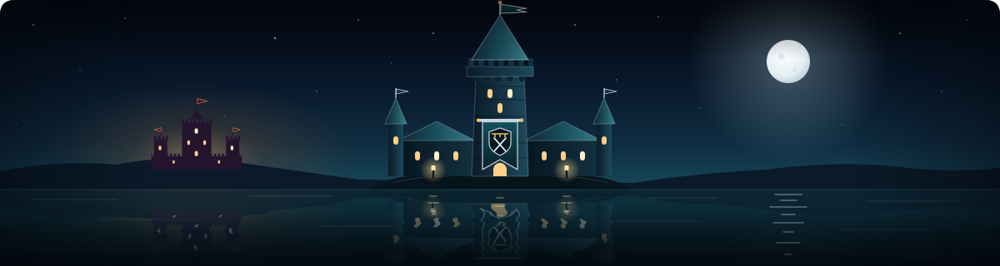
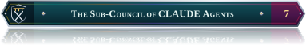
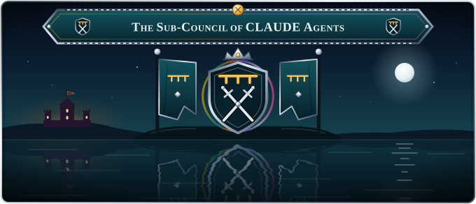
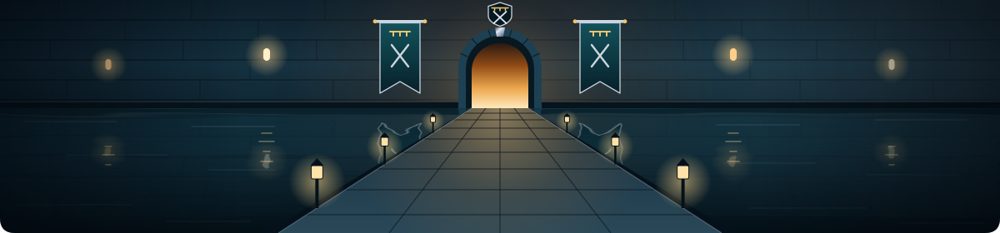

 

# AI Agent Help Instructions

 

> [!NOTE]
> Instructions were editted (and **only editted**) by:
> 
> 

 
Some instructions to help AI coding agents learn how to operate and build the project

 
 

The Sub-Council is a branch of AGRemap's [Council of CLAUDE Agents](https://github.com/nhok0169/Anime-Game-Remap/blob/master/AI%20Agent%20Help/README.md):
its crest is the Council's crossed sword and dagger, differenced with a gold *label*, the heraldic mark of a
cadet branch, and its tower stands on a lake, since an identity mod is a model's own reflection.

 
 

| Topic | Guide |
| --- | --- |
| Overview | [Overview/CLAUDE.md](Overview/CLAUDE.md) |
| Setup | [Setup/CLAUDE.md](Setup/CLAUDE.md) |
| Testing | [Testing/CLAUDE.md](Testing/CLAUDE.md) |
| Documentation | [Documentation/CLAUDE.md](Documentation/CLAUDE.md) |
| Architecture | [Architecture/CLAUDE.md](Architecture/CLAUDE.md) |
| Identity Mods | [IdentityMods/CLAUDE.md](IdentityMods/CLAUDE.md) |
| Downloads | [Downloads/CLAUDE.md](Downloads/CLAUDE.md) |

 

## Sub-Council Members

Special Thanks to ❤:

- 
- 
- 
- 

 

